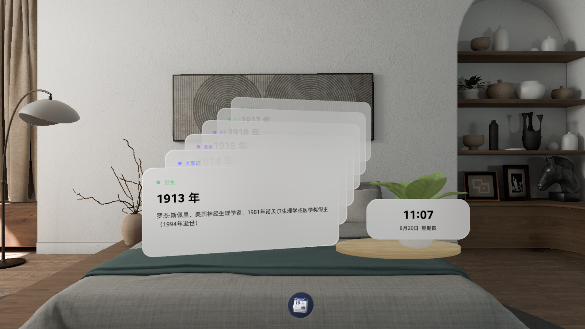

# 历史上的今天

一叠卡片浮在身边，随手翻看今天这一天发生过什么。

基于 **PICO Spatial SDK 6.0** 的 Volume（Volumetric WindowContainer）空间应用，运行于 PICO OS 6。
全部 366 天、54,018 条记录随安装包分发，**运行时不发起任何网络请求**。



## 特性

- **卡片堆叠浏览** —— 半透明卡片沿深度方向叠放，最前一张显示完整条目
- **点击翻页** —— 前卡缩小上移消散，后面一张顶上来；不操作则每 5 分钟自动翻页
- **随机起点** —— 条目按年份升序排列，但每次冷启动从随机位置开始，不会总读到同样的开头
- **三类条目** —— 大事记 / 出生 / 逝世，用一个小色点区分
- **时钟面板** —— 右下角常驻显示时间、日期与星期，跨零点自动切换到新的一天
- **完全离线** —— 无网络权限，无数据采集，无内购
- **场景摆件** —— 时钟旁的植物模型带 idle 骨骼动画，持续循环

## 数据来源与授权

本应用的条目文本来自 **中文维基百科**，经 [LuoH-AN/TodayInHistory](https://github.com/LuoH-AN/TodayInHistory)
整理后使用。构建脚本固定引用上游提交 `a40df914cfada297c775dd66e6f927da1f454fff` 的 Wikipedia 分支。

两层授权需要分别说明：

| 部分 | 来源 | 授权 |
| --- | --- | --- |
| 条目文本内容 | 中文维基百科 | [CC BY-SA 4.0](https://creativecommons.org/licenses/by-sa/4.0/deed.zh) |
| 上游整理仓库 | LuoH-AN/TodayInHistory | MIT |

> **注意**：上游仓库以 MIT 发布，但其中的条目文本源自维基百科，
> 维基百科内容采用 CC BY-SA 4.0，上游仓库的 MIT 声明不能改变这部分内容的授权。
> 因此本仓库与本应用分发这些文本时，遵循 CC BY-SA 4.0 的署名与相同方式共享条款。

如果你复用 `app/src/main/assets/history/` 下的数据，请保留上述署名。

## 构建与运行

需要 JDK 17、Android SDK（compileSdk 35）与 PICO Spatial SDK 依赖仓库。

```bash
./gradlew :app:assembleDebug          # 构建
./gradlew :app:testDebugUnitTest      # 单元测试
```

安装到模拟器或设备（[pico-cli](https://developer-cn.picoxr.com/)）：

```bash
pico-cli emulator start
pico-cli app install app/build/outputs/apk/debug/app-debug.apk
pico-cli app launch tech.illusion.todayinhistory
```

## 数据管线

`app/src/main/assets/history/{月}-{日}.json` 共 366 个文件由脚本生成，**不要手工编辑**：

```bash
python3 tools/build_history_assets.py
```

脚本从固定的上游提交拉取，解析年份、过滤无效条目、按年份升序排序，
并对产物数量做硬断言（366 天 / 保留 54,018 条 / 丢弃 175 条）。
更换上游 SHA 时必须同步更新脚本里的 `EXPECTED_*` 常量，否则断言会拦截。

每条记录的格式是 `[年份, 文本, 类型]`，类型取 `"e"`（大事记）/ `"b"`（出生）/ `"d"`（逝世）。

## 图标

分层图标由脚本从母版重新生成，可复现：

```bash
python3 tools/build_icon_assets.py
```

母版是 `docs/logo-source-cutout.png`。分层规范见 PICO 文档
`spatial-design_foundation_icon_app-icon-and-layered-design`：内容需收进 1024² 画布的内切圆，
背景层圆内不得有透明像素，高光与阴影由系统添加、素材内不得自带。
`docs/store/` 下另有商店上架用的 `icon_bg.png` / `icon_fg2.png`。

## 工程结构

```
app/src/main/java/tech/illusion/todayinhistory/
├── content/HomeVolume.kt        Volume 内容装配，面板与实体的挂载点
├── content/PlantDecor.kt       植物摆件：加载、按包围盒自动缩放、循环播放动画
├── data/                        资源读取与 JSON 解析（手写解析器，见下）
├── panels/                      SpatialUI 面板：卡片、时钟、年份标签
└── queue/                       队列状态机、槽位姿态、ECS System 与驱动
```

几处刻意的设计：

- **不使用 `org.json`** —— 它在 JVM 单元测试里是抛异常的桩实现。`HistoryRepository`
  自带一个手写解析器，因此数据层可以在纯 JVM 测试中直接跑，无需 Robolectric 或改动构建配置。
- **ECS 拥有 3D 状态** —— 每帧的姿态写入发生在 `HistoryQueueSystem` 里，
  Compose 只负责面板内容，不驱动实体变换。
- **全部 UI 使用 SpatialUI + `PicoTheme`** —— 工程内不含 Material / Material3。

## 测试

135 项 JVM 单元测试，覆盖队列状态机、姿态插值、年份格式化、类型映射与真实资源完整性：

```bash
./gradlew :app:testDebugUnitTest
```

`RealAssetIntegrityTest` 直接校验打包进 APK 的 366 个资源文件。
测试任务已声明 `src/main/assets` 为输入，改数据会正确触发重跑，不会被 UP-TO-DATE 跳过。

## 隐私

本应用**不收集、不存储、不上传任何信息**，且没有网络权限，技术上无法联网。
完整说明见 [隐私政策](docs/legal/privacy-policy.md)，其中每一条承诺都给出了自行核验的方法。

## 许可

- **数据**：见上文「数据来源与授权」，遵循 CC BY-SA 4.0。
- **代码**：[MIT](LICENSE)。
- 两者并行不冲突：MIT 覆盖本仓库源代码，CC BY-SA 4.0 覆盖随包分发的历史条目数据。
